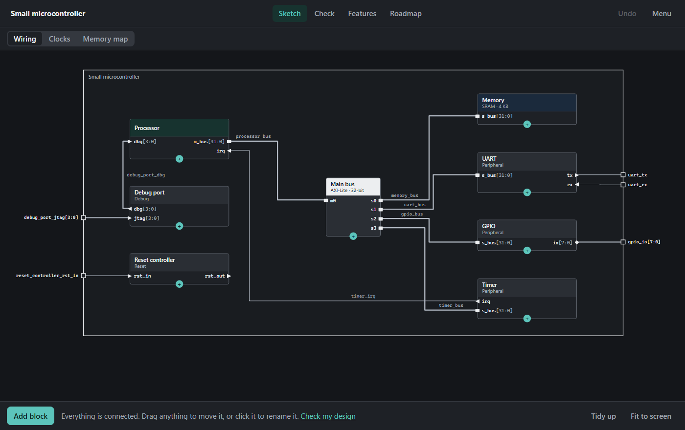

# ChipSketch

**Sketch a chip's architecture in your browser, get plain-language feedback on it, and
track what still has to be built.** Made for people learning chip design.

There is nothing to install, and it needs no internet connection or account.

## Get started

1. Download this repository: choose **Code > Download ZIP**, then unzip it.
2. Double-click `index.html`.
3. When you create your first chip, choose **Practice: spot the mistakes**. Then open the
   **Check** tab and work through the mistakes it finds.

Your work saves automatically in that browser. To keep a copy or move it to another computer,
use **Menu > Save project file**.

## What it does

| Screen | What you do |
| --- | --- |
| **Sketch** | See the chip as a diagram. Drag anything to move it, and drag a block's **+** onto another block to connect them |
| **Check** | Go through problems one at a time: what is wrong, why it matters, and how to fix it. Some have a one-click fix |
| **Features** | List what the chip must do, and move each item from To do to Built to Tested |
| **Roadmap** | Follow the eight steps from sketch to real chip, with the tools used at each step |

The checks look for mistakes such as:

- Signals crossing between clocks with nothing to make the crossing safe
- Memory and peripherals that use the same addresses
- Wires with two outputs driving them, or none at all
- Connections with mismatched widths
- Designs too big for the chip, or using too many pins
- Buses asked to carry more data than they can

Each check names the industry tools that catch the same problem in a real project.

## Reading the diagram

- **Ports** sit on the edges of blocks. A triangle shows the direction, a diamond means both
  ways, and a bar is a whole bus interface. Drag one to move it, or click to rename it.
- **Nets** are the wires, labelled with their name. Thick wires carry many bits. Drag one
  sideways to move it, or click to rename it. Connections with the same name are one net.
- **Pads** are the squares on the chip outline, where a signal leaves the chip.
- **Views** at the top show one thing at a time: Wiring, Clocks or Memory map.
- **Tidy up** puts everything back in a neat layout. Scroll to zoom.

Dotted terms are clickable, and each opens a one-sentence definition. The full list is under
**Menu > Glossary**.

## Taking it further

From the **Menu**, you can export:

- **Top-level Verilog (.v):** the top module with every net and pin, plus an empty module for
  each block. Each bus interface is one placeholder vector, to replace with its protocol's
  real signals.
- **Clock constraints (.sdc):** clock names match the Verilog.
- **Written spec (.md):** blocks, ports, nets, features and open problems.

## What it can and cannot tell you

ChipSketch finds mistakes in a plan. It does not read RTL or run any chip design tool, so **a
clean result does not mean the chip will work**. Area, clock and gate numbers are rough
starting values, not measurements. You can change them under
**Chip settings > Budgets and estimates**.

## Your saved work and shared files

- **Autosave is not private.** It is stored without encryption in your browser. Edge shares
  this storage between all HTML files opened from your computer, so another local HTML file
  you open could read or replace it. Other browsers may differ.
- **Project files can come from anyone.** Opening one replaces your current chip without asking,
  so save your own work first. Anything a file marked as "Not a problem" shows up again.

See [SECURITY.md](SECURITY.md) for details, and for how to report a problem.

## Browser support

Tested in Edge and Firefox on Windows, where the test suite passes in both and the app starts
in both. Other browsers should work, but have not been tried. Dragging has been tested with a
mouse, not on touch screens.

## Contributing

Bug reports and fixes are welcome. The project has no dependencies and no build step. See
[CONTRIBUTING.md](CONTRIBUTING.md). The design rules are in [docs/PLAN.md](docs/PLAN.md), and
[docs/RESEARCH.md](docs/RESEARCH.md) gives the sources and the basis for each estimate.

## License

[MIT](LICENSE). Product names mentioned belong to their owners, and ChipSketch is not
affiliated with any of them.
